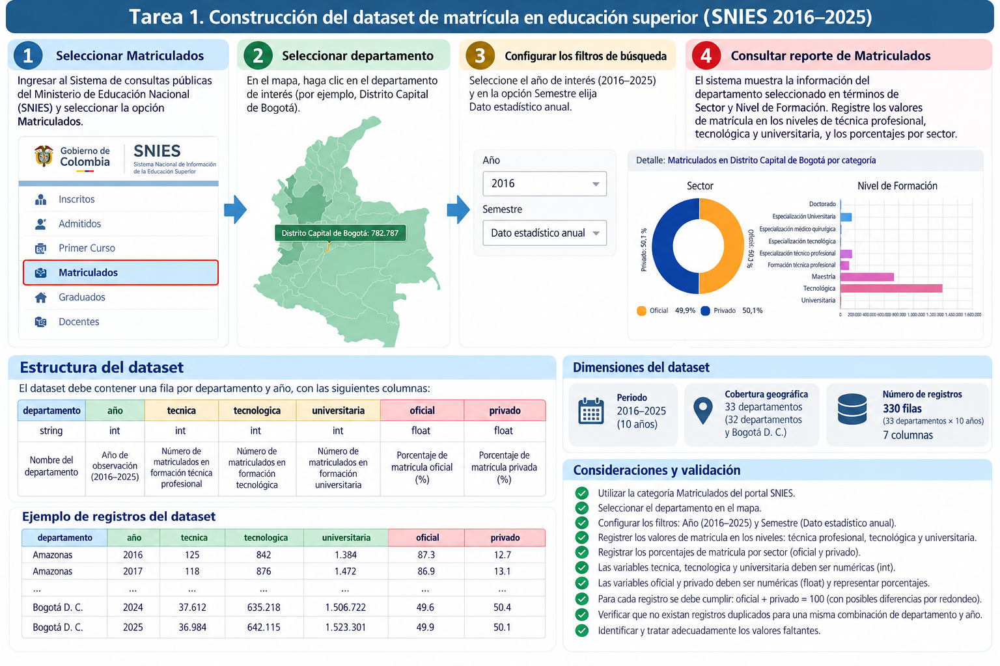
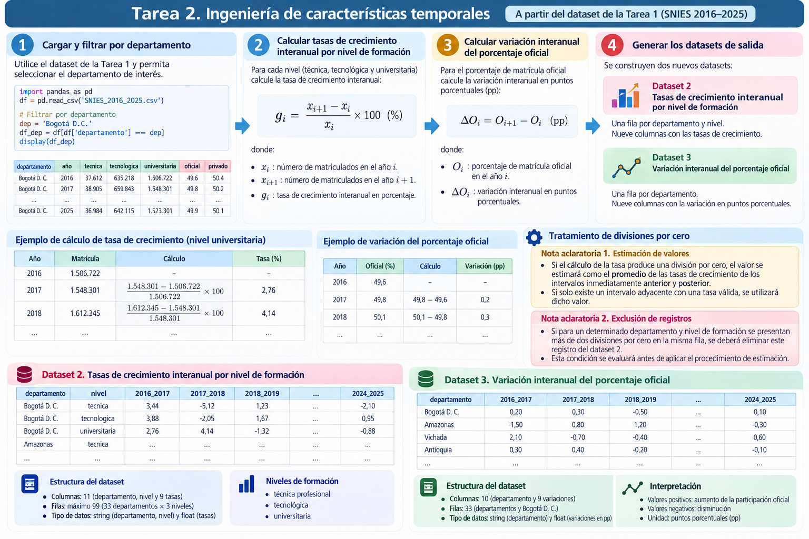
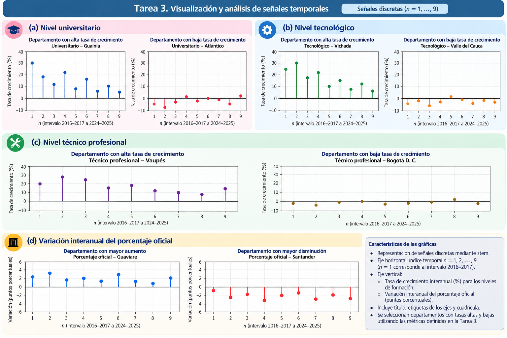
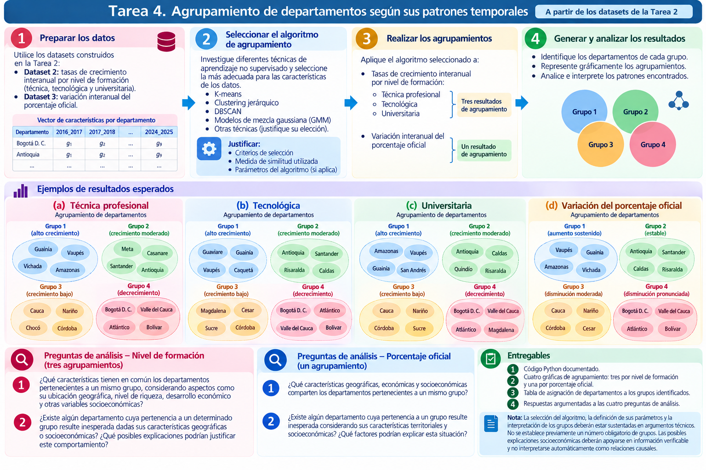
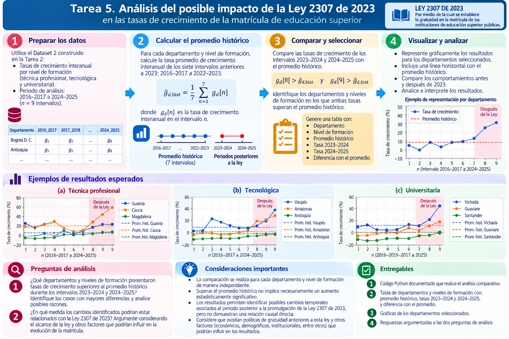
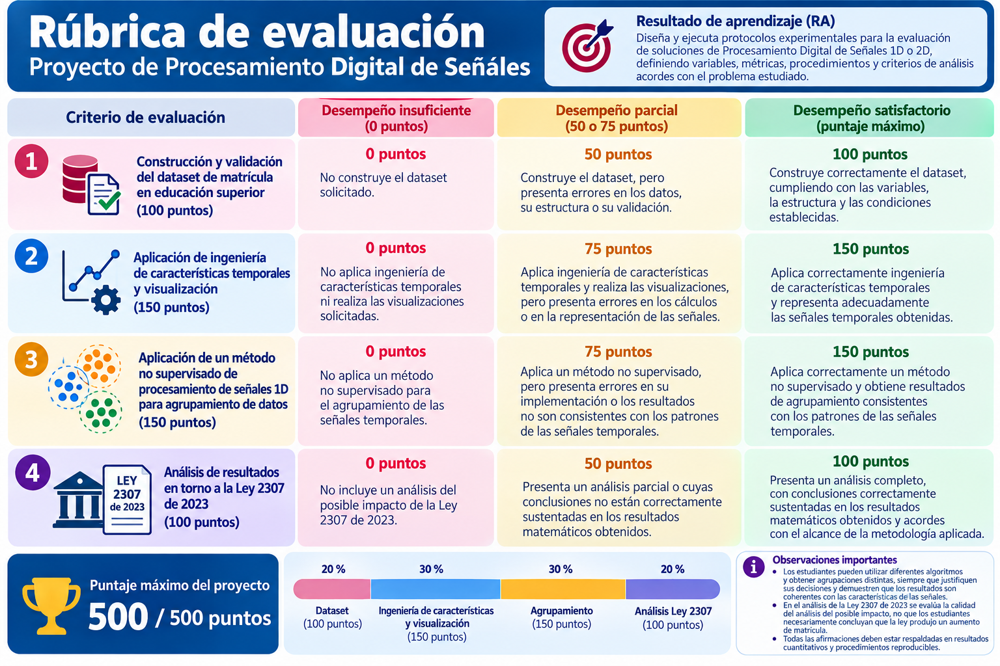

# 📡 Proyecto de Procesamiento Digital de Señales

## 🎓 Análisis de señales temporales de matrícula en educación superior en Colombia (2016–2025)

> **Resultado de aprendizaje (RA).** Diseña y ejecuta protocolos experimentales para la evaluación de soluciones de Procesamiento Digital de Señales 1D o 2D, definiendo variables, métricas, procedimientos y criterios de análisis acordes con el problema estudiado.

### Propósito del proyecto

En este proyecto se aplicarán herramientas de **procesamiento de señales unidimensionales (1D)**, ingeniería de características temporales, visualización y aprendizaje no supervisado para analizar la evolución de la matrícula en educación superior en Colombia entre 2016 y 2025. El trabajo culmina con una exploración del **posible impacto de la Ley 2307 de 2023**, a partir de comparaciones con el comportamiento histórico de cada departamento y nivel de formación.

El propósito no es confirmar una opinión previa sobre la política pública. Se espera que cada estudiante construya datos trazables, establezca condiciones equiparables de comparación, ejecute procedimientos reproducibles y formule conclusiones respaldadas por evidencia cuantitativa.

###🛠️ Fuente de información y herramientas

- **Fuente principal:** [Sistema de consultas públicas del SNIES — Ministerio de Educación Nacional](https://hecaa.mineducacion.gov.co/consultaspublicas/content/poblacional/index.jsf).
- **Cobertura temporal:** 2016–2025, con datos estadísticos anuales.
- **Cobertura territorial:** 32 departamentos y Bogotá D. C. (33 territorios).
- **Herramientas:** Python y bibliotecas apropiadas para manejo de datos, visualización y aprendizaje no supervisado.
- **Unidad de análisis:** el departamento, el nivel de formación y sus variaciones interanuales, según la tarea.

**Importante:** las cifras, departamentos y agrupamientos que aparecen en las figuras como ejemplos son *ilustrativos*. Los resultados definitivos deben obtenerse de los datos consultados y procesados por cada estudiante.

---

## 🗂️ Tarea 1. Construcción del dataset de matrícula en educación superior

1. Ingrese al portal del SNIES y seleccione **Matriculados**.
2. Seleccione cada territorio en el mapa de Colombia.
3. Configure el año de consulta entre **2016 y 2025** y el filtro **Semestre: Dato estadístico anual**.
4. Consulte la matrícula según **Nivel de Formación** y los porcentajes según **Sector**.
5. Construya un dataset con **una fila por territorio y año**.

**Estructura solicitada del Dataset 1:**

| Columna | Tipo | Descripción |
|---|---|---|
| `departamento` | `str` | Departamento o Bogotá D. C. |
| `año` | `int` | Año entre 2016 y 2025 |
| `tecnica` | `int` | Matrícula en formación técnica profesional |
| `tecnologica` | `int` | Matrícula en formación tecnológica |
| `universitaria` | `int` | Matrícula en formación universitaria |
| `oficial` | `float` | Porcentaje de matrícula del sector oficial |
| `privado` | `float` | Porcentaje de matrícula del sector privado |

**Dimensión esperada:** 330 filas (33 territorios × 10 años) y 7 columnas.

**Validaciones mínimas:** ausencia de duplicados para la combinación `departamento`–`año`; integridad de años y territorios; tipos de datos adecuados; tratamiento explícito de valores faltantes; y verificación de que `oficial + privado ≈ 100` (considerando posibles redondeos). No debe suponerse que las tres modalidades de formación suman toda la matrícula de educación superior, pues pueden existir otros niveles.

**Entregable:** Dataset 1, código de construcción o consolidación y verificaciones de calidad.

---

## ⚙️ Tarea 2. Ingeniería de características temporales

A partir del Dataset 1, construya dos conjuntos de características que representen las **variaciones entre años consecutivos**. Para cada serie de diez observaciones anuales se obtienen **nueve muestras temporales**, correspondientes a los intervalos 2016–2017, …, 2024–2025.

### 2.1. Dataset 2: crecimiento interanual por nivel de formación

Para cada departamento y cada uno de los tres niveles de formación, calcule:

$$
g_i=\frac{x_{i+1}-x_i}{x_i}\times 100\%,
$$

donde $x_i$ es el número de matriculados del año inicial del intervalo y $x_{i+1}$ el del año siguiente.

**Estructura:** columnas `departamento`, `nivel` y las nueve tasas `2016_2017`, `2017_2018`, …, `2024_2025`. Cada fila representa un par departamento–nivel; habrá **hasta 99 filas** (33 territorios × 3 niveles).

**Tratamiento de divisiones por cero:**

- Cuando una tasa no pueda calcularse por tener denominador cero, estime su valor utilizando el **promedio de las tasas válidas de los intervalos inmediatamente anterior y posterior**. Si solamente una de las dos tasas adyacentes es válida, utilícela. Identifique los valores estimados.
- **Antes de estimar**, si una fila departamento–nivel presenta **más de dos divisiones por cero**, excluya esa fila del Dataset 2. Conserve el Dataset 1 original sin alteraciones.
- Si no existe ninguna tasa adyacente válida, no invente un valor: documente el caso y el tratamiento adoptado.

### 2.2. Dataset 3: variación del porcentaje de matrícula oficial

Para cada departamento, calcule:

$$
\Delta O_i=O_{i+1}-O_i,
$$

donde $O_i$ es el porcentaje de matrícula oficial en el año $i$. El resultado se expresa en **puntos porcentuales (pp)**, no como porcentaje de crecimiento relativo.

**Estructura:** columna `departamento` y nueve variaciones interanuales. Se esperan **33 filas**.

**Entregables:** Datasets 2 y 3; código documentado de transformación; explicación de exclusiones, estimaciones y validaciones.

---

## 📈 Tarea 3. Visualización y análisis de señales temporales

Cada fila de los Datasets 2 y 3 constituye una **señal discreta de nueve muestras**. Represéntelas mediante gráficas de tipo `stem`, con índice temporal $n=1,2,\ldots,9$ en el eje horizontal y la variación correspondiente en el eje vertical.

### 3.1. Tasas de crecimiento por nivel de formación

Para **cada nivel** (técnico profesional, tecnológico y universitario):

1. Identifique un departamento con **alto crecimiento** y otro con **bajo crecimiento o decrecimiento**, justificando la selección mediante una métrica cuantitativa, como el promedio de sus nueve tasas.
2. Represente las dos señales en una figura con **dos subgráficas**.
3. Analice sus patrones temporales: máximos, mínimos, cambios de signo, oscilaciones y posibles valores atípicos.

Se esperan **seis señales en tres figuras**.

### 3.2. Variación de la participación del sector oficial

1. Seleccione un departamento con el **mayor aumento acumulado** y otro con la **mayor disminución acumulada** de la participación oficial, usando la suma de las nueve variaciones en puntos porcentuales (equivalente al cambio entre 2016 y 2025).
2. Represente ambas señales en una figura con dos subgráficas.
3. Compare sus trayectorias y describa los cambios relevantes.

Se esperan **dos señales adicionales en una figura**. En total, la tarea comprende **ocho señales y cuatro figuras**.

**Requisitos gráficos:** títulos informativos, unidades correctas, cuadrícula, línea de referencia en cero y eje horizontal $n=1,\ldots,9$. Para las tasas de matrícula, el eje vertical se expresa en **%**; para el sector oficial, en **pp**.

**Entregable:** figuras y análisis escrito que justifique la selección de departamentos e interprete los resultados.

---

## 🧩 Tarea 4. Agrupamiento de departamentos según sus patrones temporales

Diseñe y aplique un **método de aprendizaje no supervisado** que agrupe departamentos según la semejanza de sus señales temporales. Cada departamento se representa mediante un vector de **nueve características**, correspondiente a sus variaciones interanuales.

### 4.1. Agrupamientos por nivel de formación

Utilice el Dataset 2 para generar **tres agrupamientos independientes**: uno para formación técnica profesional, otro para tecnológica y otro para universitaria.

### 4.2. Agrupamiento por participación del sector oficial

Utilice el Dataset 3 para generar **un cuarto agrupamiento**, basado en la evolución de las variaciones en puntos porcentuales del sector oficial.

### Diseño metodológico

Investigue algoritmos adecuados (por ejemplo, K-means, agrupamiento jerárquico, DBSCAN o mezclas gaussianas) y **justifique** el algoritmo seleccionado, la medida de similitud o distancia, las transformaciones de los datos, los parámetros y el criterio de elección de grupos, cuando corresponda. **No existe un número de grupos predeterminado.**

### Preguntas de análisis

**Para los tres agrupamientos por nivel de formación:**

1. ¿Qué características geográficas, económicas y socioeconómicas comparten los departamentos que pertenecen a un mismo grupo?
2. ¿Existe algún departamento cuya pertenencia a un grupo resulte inesperada dadas sus características territoriales o socioeconómicas? ¿Qué explicaciones podrían justificarlo?

**Para el agrupamiento del porcentaje oficial:**

1. ¿Qué características geográficas, económicas y socioeconómicas comparten los departamentos que pertenecen a un mismo grupo?
2. ¿Existe algún departamento cuya pertenencia a un grupo resulte inesperada considerando su contexto territorial y socioeconómico? ¿Qué factores podrían explicar esta situación?

**Entregables:** código documentado; cuatro resultados de agrupamiento con visualizaciones; tabla de asignación de departamentos a los grupos; justificación técnica del método; y respuestas argumentadas a las cuatro preguntas. Las explicaciones contextuales deben apoyarse en información verificable y **no deben confundirse con relaciones causales demostradas**.

---

## 🔎 Tarea 5. Análisis del posible impacto de la Ley 2307 de 2023

A partir del Dataset 2, examine si los crecimientos interanuales posteriores a 2023 superan el comportamiento histórico de **cada departamento y nivel de formación**.

### 5.1. Definición del referente histórico

Para cada par departamento–nivel, calcule la media de las **siete tasas anteriores** a los intervalos posteriores a 2023:

$$
\overline{g}_{d,\mathrm{hist}}=\frac{1}{7}\sum_{n=1}^{7}g_d[n],
$$

que corresponden a los intervalos **2016–2017 a 2022–2023**.

### 5.2. Comparación con los intervalos posteriores

Compare **por separado** las tasas de **2023–2024** ($g_d[8]$) y **2024–2025** ($g_d[9]$) con el promedio histórico. Seleccione los pares departamento–nivel que cumplan **simultáneamente**:

$$
g_d[8]>\overline{g}_{d,\mathrm{hist}}
\qquad\text{y}\qquad
g_d[9]>\overline{g}_{d,\mathrm{hist}}.
$$

### 5.3. Presentación e interpretación

- Construya una tabla con departamento, nivel de formación, promedio histórico, tasas de 2023–2024 y 2024–2025, y diferencias de cada tasa frente al promedio.
- Represente gráficamente los casos seleccionados, indicando las nueve tasas, la **línea horizontal del promedio histórico** y los dos intervalos posteriores a 2023.
- Responda las siguientes preguntas:

**Pregunta 1.** ¿Qué departamentos y niveles de formación presentaron tasas de crecimiento superiores a su promedio histórico en **ambos** intervalos posteriores a 2023? ¿Cuáles registraron las mayores diferencias y qué patrones se observan?

**Pregunta 2.** ¿En qué medida los cambios identificados podrían estar relacionados con la Ley 2307 de 2023? Argumente teniendo en cuenta el alcance de la ley y otros factores que podrían influir en la evolución de la matrícula.

**Precauciones de interpretación:** la Ley 2307 de 2023 establece la gratuidad de matrícula para programas de pregrado en instituciones de educación superior públicas. Las tasas por nivel de formación construidas en este proyecto reúnen matrícula de distintos sectores, por lo que **no miden aisladamente el efecto sobre las instituciones públicas**. La existencia de antecedentes de gratuidad no implica que fueran equivalentes a la ley. Asimismo, observar incrementos posteriores a su promulgación **no demuestra por sí solo una relación causal** ni significancia estadística. Las conclusiones deben formularse dentro del alcance descriptivo del protocolo.

**Entregables:** código reproducible; tabla comparativa; gráficas; respuestas sustentadas a las dos preguntas.

---

## 🏅 Rúbrica de evaluación — 500 puntos

| Criterio | No realizado | Parcial o con errores | Correcto | Máximo |
|---|---:|---:|---:|---:|
| Construcción y validación del dataset | 0 | 50 | 100 | **100** |
| Ingeniería de características temporales y visualización | 0 | 75 | 150 | **150** |
| Método no supervisado para agrupamiento de señales 1D | 0 | 75 | 150 | **150** |
| Análisis de resultados en torno a la Ley 2307 de 2023 | 0 | 50 | 100 | **100** |
| **Total** | | | | **500** |

Los niveles de desempeño se interpretan conforme a las descripciones de la figura. En particular, **un agrupamiento válido no tiene que coincidir con grupos preconcebidos**: debe estar correctamente implementado y ser coherente con los patrones temporales. Asimismo, **la evaluación del análisis de la ley no depende de concluir que esta tuvo un efecto positivo o negativo**, sino de la solidez del procedimiento y la argumentación.

## Condiciones generales de entrega y rigor académico

1. Entregue un **notebook de Python (`.ipynb`)** organizado por tareas, con código ejecutable, explicaciones, gráficas y análisis.
2. Incluya los **tres datasets** generados o utilizados, identificando sus nombres y estructura.
3. Identifique claramente la fuente de los datos y las fuentes adicionales utilizadas para el contexto territorial.
4. Documente cualquier exclusión, estimación, transformación o decisión metodológica que pueda modificar los resultados.
5. Distinga entre **hechos observados, interpretaciones, hipótesis y afirmaciones causales**. No presente correlaciones o cambios temporales como pruebas automáticas de causalidad.
6. Se permite utilizar herramientas de **inteligencia artificial como apoyo para programar**, pero las decisiones metodológicas, la evaluación de resultados y las conclusiones deben ser propias y estar justificadas.

> **Principio del proyecto:** una afirmación es tan sólida como la evidencia y el procedimiento que la sustentan. Comparar datos exige definir variables, unidades, periodos y condiciones equiparables.
